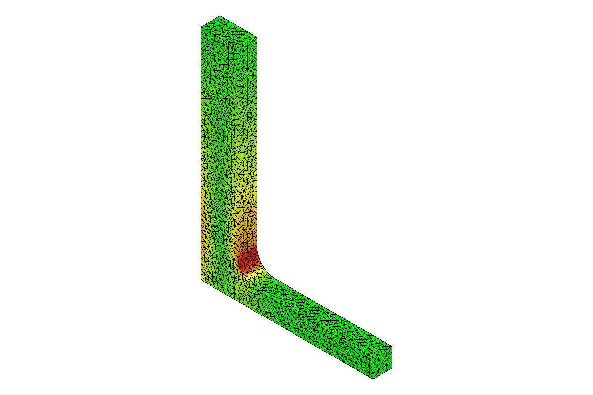
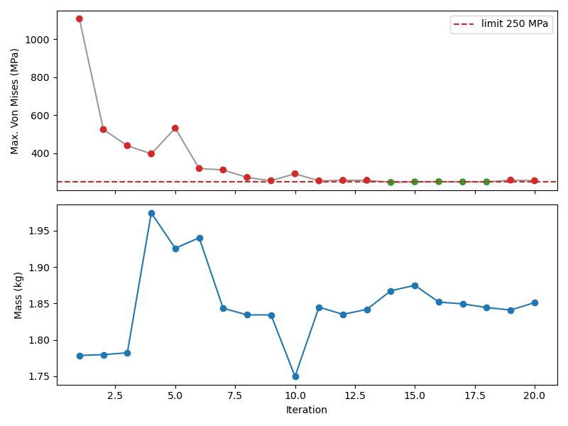
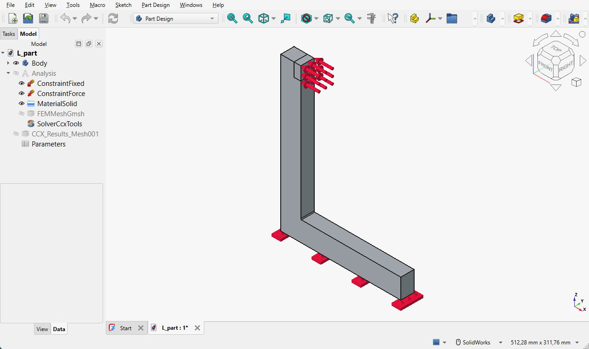
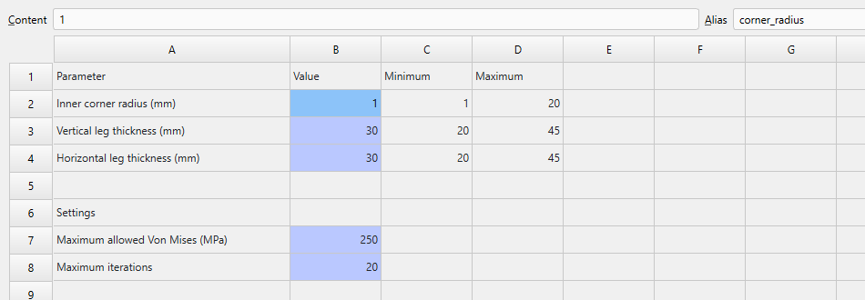
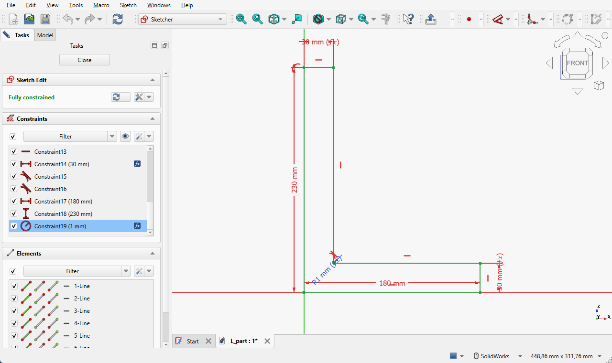
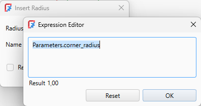

# FreeCAD + CalculiX shape optimizer

A tool that takes a FreeCAD part already set up with a stress analysis and
searches, on its own, for **the lightest version of the part whose maximum Von
Mises stress stays below a limit** you choose. It changes the dimensions you
released (a radius, a thickness...), meshes the part, runs CalculiX, measures the
stress and repeats. Live, the FreeCAD window shows the part changing shape and
[PrePoMax](https://prepomax.fs.um.si/) shows the result of each analysis, with
the Von Mises colors and the stress color bar.

No AI involved: it is classic parametric optimization (SciPy's COBYLA algorithm).



## Requirements

- Windows
- [FreeCAD 1.1](https://www.freecad.org/downloads.php) installed (it already ships
  Gmsh, CalculiX, NumPy, SciPy and Matplotlib — nothing else to install)
- Python 3 on the system, only to run the `optimize.py` command (the computation
  itself runs inside FreeCAD's Python)
- [PrePoMax](https://prepomax.fs.um.si/) (optional, tested with 2.6) to view the
  stresses. Without it, the colors are shown in the FreeCAD window itself.

If FreeCAD is not in `C:\Program Files\FreeCAD 1.1`, use
`--freecad "C:\path\FreeCAD 1.1\bin"` or set the `FREECAD_BIN` environment variable.

PrePoMax is searched for in `Documents`, `Desktop`, `Downloads` and
`Program Files` (folders whose names start with `PrePoMax`). If it is somewhere
else, use `--prepomax "C:\path\PrePoMax v2.6.0"` or the `PREPOMAX_BIN`
variable. To not open it, use `--no-prepomax`.

## Running the example

In a terminal (for example VS Code's), in the project folder:

```powershell
python optimize.py examples\L_part.FCStd --check      # checks that the part is ready
python optimize.py examples\L_part.FCStd              # optimizes live: FreeCAD + PrePoMax
python optimize.py examples\L_part.FCStd --headless   # same thing, without opening windows
```

The example is a steel L bracket (180 × 230 mm, 20 mm thick), fixed at its base
with 5000 N pushing the top of the vertical leg. The free parameters are the
inner corner radius and the thicknesses of both legs; the limit is 250 MPa.

The terminal shows one line per iteration:

```
iter  corner_radius  vertical_thickness  horizontal_thickness  VonMises_max       mass    status
   1            1.0                30.0                  30.0      1108 MPa    1.78 kg    above limit (lowest stress so far)
   2            5.8                30.0                  30.0       524 MPa    1.78 kg    above limit (lowest stress so far)
 ...
  18           20.0                38.7                  20.0       248 MPa    1.84 kg    OK ✓ best so far
```

Result of the example (20 iterations, the default):

| | Corner radius | Vertical leg | Horizontal leg | Max. Von Mises | Mass |
|---|---|---|---|---|---|
| Original | 1 mm | 30 mm | 30 mm | 1108 MPa | 1.78 kg |
| Optimized | 20 mm | 38.7 mm | 20 mm | 248 MPa ✓ | 1.84 kg (+4%) |

The tool rounded the corner as much as allowed, thickened the vertical leg (where the
bending moment is) and thinned the horizontal one, which barely works, to offset the weight.



Meanwhile the screen is split: **FreeCAD on the left**, showing the part changing
shape (with a narrow Model/Tasks panel so the part shows up larger), and **a single
PrePoMax window on the right**, updated with the result of each iteration, already on
**STRESS → MISES** (MPa), with the color bar and in the isometric view. Each swap
takes about 10 s; if the next iteration finishes before that, PrePoMax jumps straight
to the newest one. At the end it stays open with the best iteration. Each iteration
takes 10 to 20 s. The split only applies to this run: afterwards FreeCAD opens again
with its usual window and panel sizes.
**Ctrl+C** in the terminal stops after the current iteration and keeps the best result so far.

To update the same window, the tool drives PrePoMax itself (*File → Open*, picks the
mm/ton/s units and turns the view): during the optimization, leave its window alone.
It is always closed as if by the X button; if you kill it (Task Manager), next time
PrePoMax asks whether to recover the session — the tool keeps a copy of that recovery
file in `results\...\work\` and answers no. What happened to the window is logged in
`results\...\work\prepomax_window.log`.

### What each status means

| Status | Meaning |
|---|---|
| `OK ✓` | Von Mises below the limit. |
| `OK ⚠ check` | Below the limit outside the zones near the fixed constraints and forces, but there is a peak above the limit *inside* them, or the maximum is at their edge. It may be a numerical artifact or a real critical point: check it. |
| `above limit` | Von Mises above the limit. |
| `invalid` | Could not be evaluated (impossible geometry, mesh failed, a fixed constraint/force moved to another face...). The reason is shown on the line. |

### Results

Each run creates `results\<part>_<date-time>\` with:

- `<part>_optimized.FCStd` — the best version, with the FEM results inside;
- `<part>_optimized.frd` — the CalculiX result of the best version, to open in
  PrePoMax whenever you want (*File → Open*);
- `history.csv` — every attempt;
- `chart.png` — stress and mass per iteration;
- `view.png` — the final part painted by Von Mises (window mode);
- `log.txt` — everything shown in the terminal.

The original file is **never changed**.

## Tutorial: preparing a new part

The tool does not need to know anything about your part: everything goes inside the
`.FCStd`. There are two steps in FreeCAD, done once per part.

### 1. The stress analysis (FEM workbench)

1. Model the part as usual (PartDesign: Body, Sketch, Pad...).
2. Switch to the **FEM** workbench.
3. **Analysis container** (the "A" icon): creates the analysis with the CalculiX solver.
4. **Material for solid**: choose the material (e.g. steel). Its density is used to
   compute the mass.
5. **Fixed boundary condition**: select the fixed face(s).
6. **Force load**: select the face where the force is applied, enter the value (N)
   and the direction.
7. **FEM mesh from shape by Gmsh**: select the Body. The *maximum element size*
   (e.g. 5 mm) sets the accuracy — and the time — of each iteration.
8. Run it once from FreeCAD itself (double-click the solver → *Run*) to check that
   everything is right.



### 2. The `Parameters` spreadsheet

It lists **only what may change**. Anything not in it stays as it is.

1. **Spreadsheet** workbench → *Create spreadsheet*. Rename it to `Parameters`.
2. One row per parameter: description in column A, value in **B**, minimum in
   **C** and maximum in **D**.
3. Give the value cell an **alias** (name): right-click cell B → *Properties* →
   *Alias*, e.g. `corner_radius`.
4. Further down, settings cells (also with an alias):

| Alias | Required | What it is |
|---|---|---|
| `stress_limit` | yes | maximum allowed Von Mises, in MPa (e.g. yield strength ÷ safety factor) |
| `max_iterations` | no (20) | maximum number of analyses; on reaching it the optimization stops, whether the limit was reached or not, and delivers the best combination found |
| `exclusion_zone_mm` | no (2 × element size) | radius of the zone ignored around fixed constraints and forces |
| `exclude_<Name>` | no (1) | `0` to *not* ignore the zone of one condition, e.g. `exclude_ConstraintFixed` |

Example (the L part spreadsheet):

|   | A | B | C | D |
|---|---|---|---|---|
| 1 | Parameter | Value | Minimum | Maximum |
| 2 | Inner corner radius (mm) | `corner_radius` = 1 | 1 | 20 |
| 3 | Vertical leg thickness (mm) | `vertical_thickness` = 30 | 20 | 45 |
| 4 | Horizontal leg thickness (mm) | `horizontal_thickness` = 30 | 20 | 45 |
| 6 | Settings | | | |
| 7 | Maximum allowed Von Mises (MPa) | `stress_limit` = 250 | | |
| 8 | Maximum iterations | `max_iterations` = 20 | | |



In the spreadsheet, select a cell to see its alias in the **Alias** field at the top.

### 3. Linking the dimensions to the spreadsheet

In the Sketcher, double-click a dimension; in the value field click the **f(x)**
button and type `Parameters.corner_radius`. The dimension now follows the
spreadsheet. It works the same for the length of a Pad or any other numeric field.



In the dimension dialog, the **f(x)** button opens the expression editor:



**Corner radius: use the Sketcher fillet**, not the PartDesign Fillet applied to the
edge. The PartDesign one depends on the edge "name", which may change when another
dimension changes (FreeCAD's topological naming problem); the Sketcher one does not.

### 4. Check and run

```powershell
python optimize.py my_part.FCStd --check
python optimize.py my_part.FCStd
```

`--check` lists what is missing: analysis, fixed constraint, force, parameters
without minimum/maximum, aliases that no dimension uses, etc.

## Why the stress at a sharp corner cannot be trusted

At a 90° inner corner without a radius, the computed stress **keeps growing** as the
mesh gets finer: there is no "true" value. That is why the first parameter to release
is usually a corner radius — it turns that infinite peak into a real value that can be
compared between iterations.

The same goes for the edges of the faces holding the fixed constraints and the force:
there the mesh creates peaks that do not exist in the real part. That is why the tool
ignores a small zone around them (`exclusion_zone_mm`). But a real peak may also be
there — hence the `OK ⚠ check` status and the `exclude_<Name> = 0` option.

## Running the tests

```powershell
& "C:\Program Files\FreeCAD 1.1\bin\python.exe" -m unittest discover -s tests -t . -v
```

The end-to-end tests run the real FreeCAD (some open its window) and take a few
minutes.

The example `examples\L_part.FCStd` was generated by `tools\prepare_L_example.py`
from the original L part (`tests\data\L_part_original.FCStd`, without spreadsheet and
with a sharp corner); the script shows how to prepare a part with code.

## License

MIT
