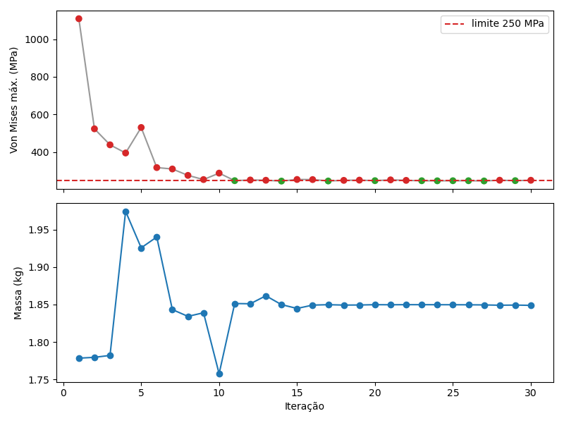
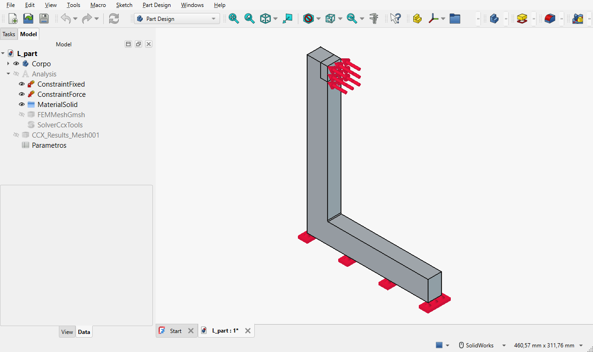
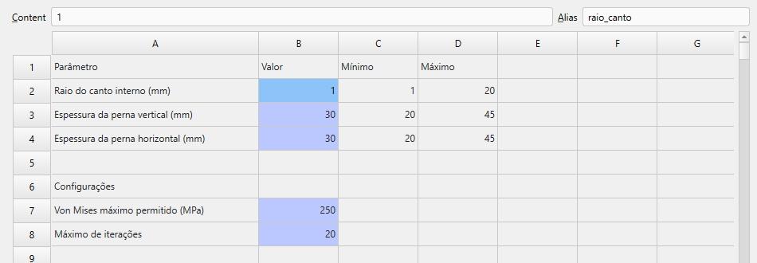
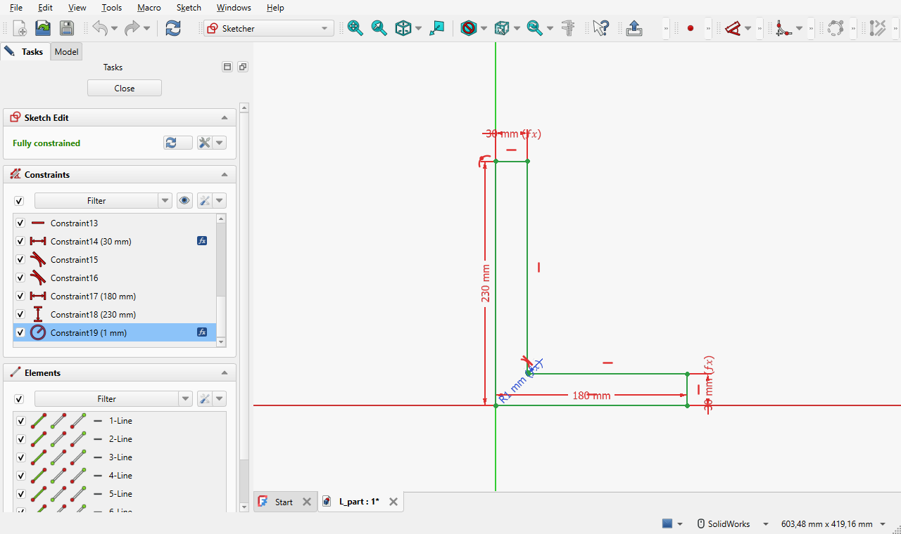
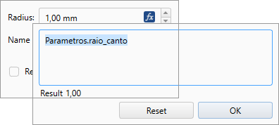

# Otimizador de forma FreeCAD + CalculiX

Ferramenta que pega uma peça do FreeCAD já preparada com uma análise de tensões
e procura, sozinha, **a versão mais leve da peça cujo Von Mises máximo fique
abaixo de um limite** que você define. Ela muda as cotas que você liberou (um
raio, uma espessura...), gera a malha, roda o CalculiX, mede a tensão e repete.
Ao vivo, a janela do FreeCAD mostra a peça mudando de forma e o
[PrePoMax](https://prepomax.fs.um.si/) mostra o resultado de cada análise, com
as cores de Von Mises e a barra de tensão.

Não usa IA: é otimização paramétrica clássica (algoritmo COBYLA do SciPy).


## Requisitos

- Windows
- [FreeCAD 1.1](https://www.freecad.org/downloads.php) instalado (já traz Gmsh,
  CalculiX, NumPy, SciPy e Matplotlib — não é preciso instalar mais nada)
- Python 3 no sistema, só para rodar o comando `otimizar.py` (o cálculo em si
  roda dentro do Python do FreeCAD)

- [PrePoMax](https://prepomax.fs.um.si/) (opcional, testado com a 2.6) para ver
  as tensões. Sem ele, as cores aparecem na própria janela do FreeCAD.

Se o FreeCAD não estiver em `C:\Program Files\FreeCAD 1.1`, use
`--freecad "C:\caminho\FreeCAD 1.1\bin"` ou defina a variável de ambiente `FREECAD_BIN`.

O PrePoMax é procurado em `Documentos`, `Área de Trabalho`, `Downloads` e
`Arquivos de Programas` (pastas que começam com `PrePoMax`). Se estiver em
outro lugar, use `--prepomax "C:\caminho\PrePoMax v2.6.0"` ou a variável
`PREPOMAX_BIN`. Para não abri-lo, use `--sem-prepomax`.

## Rodando o exemplo

No terminal do VS Code, na pasta do projeto:

```powershell
python otimizar.py exemplos\L_part.FCStd --checar          # confere se a peça está pronta
python otimizar.py exemplos\L_part.FCStd                   # otimiza ao vivo: FreeCAD + PrePoMax
python otimizar.py exemplos\L_part.FCStd --sem-interface   # mesma coisa, sem abrir janelas
```

O exemplo é uma cantoneira em L de aço (180 × 230 mm, 20 mm de espessura), presa
pela base e com 5000 N empurrando o topo da perna vertical. Os parâmetros livres
são o raio do canto interno e as espessuras das duas pernas; o limite é 250 MPa.

No terminal aparece uma linha por iteração:

```
iter  raio_canto  espessura_vertical  espessura_horizontal  VonMises_max      massa    status
   1         1.0                30.0                  30.0      1108 MPa    1.78 kg    acima do limite (menor tensão até agora)
   2         5.8                30.0                  30.0       524 MPa    1.78 kg    acima do limite (menor tensão até agora)
 ...
```

Resultado do exemplo (30 iterações):

| | Raio do canto | Perna vertical | Perna horizontal | Von Mises máx. | Massa |
|---|---|---|---|---|---|
| Original | 1 mm | 30 mm | 30 mm | 1108 MPa | 1,78 kg |
| Otimizada | 20 mm | 38,9 mm | 20 mm | 249 MPa ✓ | 1,85 kg (+4%) |

A ferramenta arredondou o canto ao máximo, engrossou a perna vertical (onde
está o momento fletor) e afinou a horizontal, que quase não trabalha, para
compensar o peso.



Enquanto isso, a tela fica dividida: **à esquerda o FreeCAD**, mostrando a peça
mudando de forma (com o painel Model/Tasks estreito, para a peça aparecer maior), e **à direita uma única janela do PrePoMax**, atualizada com o
resultado de cada iteração, já em
**STRESS → MISES** (MPa), com a barra de cores e na vista isométrica. A troca leva
uns 10 s; se a próxima iteração terminar antes, o PrePoMax pula direto para a mais
nova. No fim, ele fica aberto com a melhor iteração. Cada iteração leva de 10 a 20 s.
A divisão vale só para essa execução: depois, o FreeCAD volta a abrir com a janela e
os painéis do tamanho de sempre.
**Ctrl+C** no terminal para depois da iteração atual e guarda o melhor resultado até ali.

Para atualizar a mesma janela, o programa usa o próprio PrePoMax (*File → Open*,
escolhe as unidades mm/ton/s e gira a vista): durante a otimização, deixe a janela
dele em paz. Ele é sempre fechado como pelo X; se você o fechar à força
(Gerenciador de Tarefas), na próxima vez o PrePoMax pergunta se quer recuperar a
sessão — o programa guarda uma cópia desse arquivo de recuperação em
`resultados\...\trabalho\` e responde que não. O que aconteceu com a janela fica em
`resultados\...\trabalho\prepomax_janela.log`.

### O que significa cada status

| Status | Significado |
|---|---|
| `OK ✓` | Von Mises abaixo do limite. |
| `OK ⚠ verificar` | Abaixo do limite fora das zonas perto da fixação e da força, mas há um pico acima do limite *dentro* delas, ou o máximo está na borda delas. Pode ser artefato numérico ou um ponto crítico real: confira. |
| `acima do limite` | Von Mises acima do limite. |
| `inválida` | Não deu para avaliar (geometria impossível, malha falhou, fixação/força mudou de face...). O motivo aparece na linha. |

### Resultados

Cada execução cria `resultados\<peça>_<data-hora>\` com:

- `<peça>_otimizada.FCStd` — a melhor versão, com os resultados FEM dentro;
- `<peça>_otimizada.frd` — o resultado do CalculiX da melhor versão, para abrir
  no PrePoMax quando quiser (*File → Open*);
- `historico.csv` — todas as tentativas (abre direto no Excel em português);
- `grafico.png` — tensão e massa por iteração;
- `vista.png` — a peça final pintada pelo Von Mises (modo com janela);
- `log.txt` — tudo o que apareceu no terminal.

O arquivo original **nunca é alterado**.

## Tutorial: preparando uma peça nova

A ferramenta não precisa saber nada sobre a sua peça: tudo vai dentro do `.FCStd`.
São dois passos no FreeCAD, feitos uma vez por peça.

### 1. A análise de tensões (bancada FEM)

1. Modele a peça normalmente (PartDesign: Body, Sketch, Pad...).
2. Troque para a bancada **FEM**.
3. **Analysis container** (ícone "A"): cria a análise com o solver CalculiX.
4. **Material for solid**: escolha o material (ex.: aço). A densidade dele é
   usada para calcular a massa.
5. **Fixed boundary condition**: selecione a(s) face(s) presa(s).
6. **Force load**: selecione a face onde a força entra, informe o valor (N) e a
   direção.
7. **FEM mesh from shape by Gmsh**: selecione o Body. O *tamanho máximo de
   elemento* (ex.: 5 mm) define a precisão — e o tempo — de cada iteração.
8. Rode uma vez pelo próprio FreeCAD (duplo clique no solver → *Run*) para ver
   se está tudo certo.



### 2. A planilha `Parametros`

Ela lista **só o que pode mudar**. Tudo que não estiver nela fica como está.

1. Bancada **Spreadsheet** → *Create spreadsheet*. Renomeie para `Parametros`.
2. Uma linha por parâmetro: descrição na coluna A, valor na **B**, mínimo na
   **C** e máximo na **D**.
3. Dê um **alias** (nome) à célula do valor: clique com o botão direito na
   célula B → *Properties* → *Alias*, ex.: `raio_canto`.
4. Mais abaixo, células de configuração (também com alias):

| Alias | Obrigatório | O que é |
|---|---|---|
| `tensao_limite` | sim | Von Mises máximo permitido, em MPa (ex.: escoamento ÷ fator de segurança) |
| `max_iteracoes` | não (20) | quantas análises no máximo; ao chegar nesse número a otimização para, tendo atingido o limite ou não, e entrega a melhor combinação encontrada |
| `zona_exclusao_mm` | não (2 × tamanho de elemento) | raio da zona ignorada em volta das fixações e forças |
| `excluir_<Nome>` | não (1) | `0` para *não* ignorar a zona de uma condição, ex.: `excluir_ConstraintFixed` |

Exemplo (a planilha da peça em L):

|   | A | B | C | D |
|---|---|---|---|---|
| 1 | Parâmetro | Valor | Mínimo | Máximo |
| 2 | Raio do canto interno (mm) | `raio_canto` = 1 | 1 | 20 |
| 3 | Espessura da perna vertical (mm) | `espessura_vertical` = 30 | 20 | 45 |
| 4 | Espessura da perna horizontal (mm) | `espessura_horizontal` = 30 | 20 | 45 |
| 6 | Configurações | | | |
| 7 | Von Mises máximo permitido (MPa) | `tensao_limite` = 250 | | |
| 8 | Máximo de iterações | `max_iteracoes` = 20 | | |



Na planilha, selecione uma célula para ver o alias dela no campo **Alias**, no alto.

### 3. Ligar as cotas à planilha

No Sketcher, dê duplo clique numa cota; no campo do valor clique no botão
**f(x)** e digite `Parametros.raio_canto`. A cota passa a obedecer à planilha.
Funciona igual para o comprimento de um Pad ou qualquer outro campo numérico.



No diálogo da cota, o botão **f(x)** abre o editor da expressão:



**Raio de canto: use o fillet do Sketcher**, não o Fillet do PartDesign aplicado
na aresta. O do PartDesign depende do "nome" da aresta, que pode mudar quando
outra cota muda (o problema de nomes topológicos do FreeCAD); o do Sketcher não.

### 4. Conferir e rodar

```powershell
python otimizar.py minha_peca.FCStd --checar
python otimizar.py minha_peca.FCStd
```

O `--checar` lista, em português, o que falta: análise, fixação, força,
parâmetros sem mínimo/máximo, alias que nenhuma cota usa, etc.

## Por que a tensão de um canto vivo não é confiável

Num canto interno de 90° sem raio, a tensão calculada **cresce sem parar** à
medida que a malha fica mais fina: não existe um valor "verdadeiro". Por isso o
primeiro parâmetro a liberar costuma ser um raio no canto — ele transforma esse
pico infinito num valor real que dá para comparar entre iterações.

O mesmo vale para as bordas das faces onde estão a fixação e a força: ali a
malha cria picos que não existem na peça real. Por isso a ferramenta ignora uma
pequena zona em volta delas (`zona_exclusao_mm`). Mas um pico real também pode
estar ali — por isso o status `OK ⚠ verificar` e a opção `excluir_<Nome> = 0`.

## Rodando os testes

```powershell
& "C:\Program Files\FreeCAD 1.1\bin\python.exe" -m unittest discover -s tests -t . -v
```

Os testes de ponta a ponta rodam o FreeCAD de verdade (alguns abrem a janela)
e levam alguns minutos.

O exemplo `exemplos\L_part.FCStd` foi gerado por `ferramentas\preparar_exemplo_L.py`
a partir da peça em L original (`tests\dados\L_part_original.FCStd`, sem planilha e
com canto vivo); o script mostra como preparar uma peça por código.

## Licença

MIT
